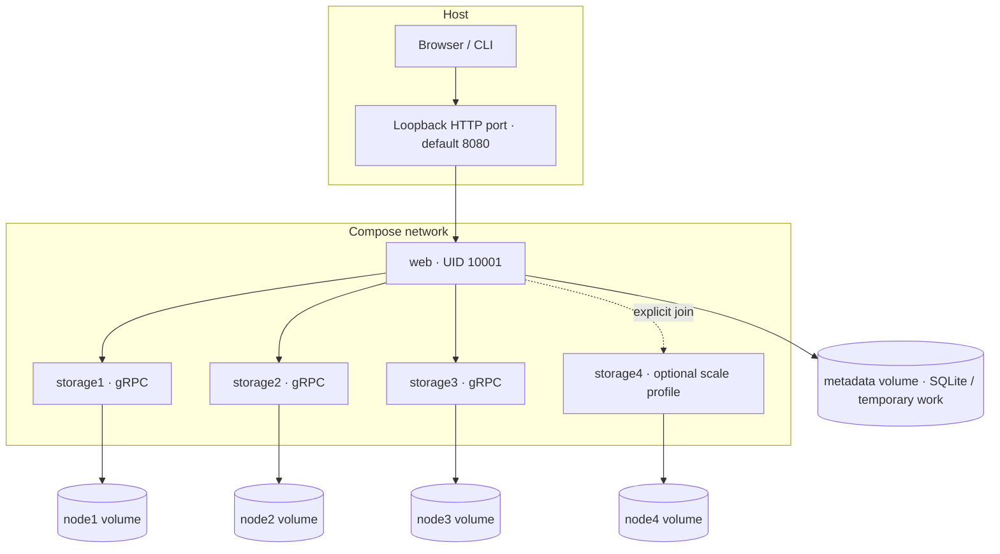

# TritonTube design

## Scope and architecture

TritonTube prioritizes a runnable, independently implemented vertical slice.
One Go HTTP coordinator uses a metadata repository, a ring snapshot and gRPC clients.
SQLite is the default; native etcd is an optional metadata backend.
Three storage processes own independent filesystem roots. FFmpeg is an external,
cancellable subprocess. Templates/CSS/JavaScript are embedded in the web binary.
The admin binary calls the same HTTP membership API used by any trusted local admin.

The SQLite implementation lives behind `metadata.Repository`. Cluster code depends
only on its smaller inventory/transaction interface; it does not import SQLite.
The optional etcd implementation is isolated in `internal/metadata/etcdstore` and
uses the official v3 client and native Raft-backed cluster. It has independent
persistence logic and no SQLite fallback. Backend-independent not-found errors keep
SQL-specific details out of the HTTP layer. Its three-member leader-failure test is
executed separately from the default SQLite tests; see docs/ETCD.md for deployment,
CAS snapshot schema, capacity bounds and recorded failover results.

## Hashing and ownership

`hashring.Hash` hashes UTF-8 key bytes with SHA-256 and interprets the first eight
bytes as a big-endian uint64. Virtual nodes hash `node:<ID byte length>:<ID>:<index>`.
IDs are case-sensitive and independent of network addresses. Default virtual-node
count is 100, configurable from 1 through 10,000. The count is persisted and checked
on startup; changing it silently would invalidate ownership.

Positions sort by uint64, then lexicographic node ID, then virtual-node index.
This defines collision ownership independently of membership input order. A lookup
uses binary search to select the first position greater than or equal to a file's
hash, wrapping to the first position past the end. Empty rings return an error.
Adding a node only moves files to that node. Tests measure 10,000 file-key samples
and enforce a reasonable remapping band for three to four nodes.

All source, manifest and segment keys are `videoID/relativeFilename`. Inventory
records key, size, SHA-256 and current owner, including failed-video outputs.
Published routing is a deterministic function of committed membership. Migration
cross-checks recorded ownership against the old ring before copying. The selected backend commits
new membership and ownership atomically; startup reconstructs that exact ring.
There is no fallback that could silently serve a stale duplicate from another node.

## Storage publication and transfer

The protobuf service streams uploads/downloads in 64 KiB messages. Upload headers
include a canonical key and required SHA-256; a server enforces a 1 GiB file limit,
hashes incrementally and publishes only after a matching checksum, file sync, close
and atomic rename. Temporary files are created under a reserved staging directory
with random names. Failure leaves any prior final file intact. Generated bindings
are standard tool output; handwritten application code is original.

Canonical relative-path validation rejects absolute paths, dot components,
backslashes, NUL and reserved dot directories. Go `os.Root` confines filesystem
operations even in the presence of symlinks; lexical checks alone would not suffice.
List streams inventory metadata and calculates checksums without loading files into
memory. Delete returns errors for missing files. Health uses standard gRPC health.
A unary Info RPC exposes the storage directory's persistent random 128-bit identity,
created in `.node-id` on first startup. Reserved dot files are excluded from media
inventory. Restarting a node preserves this identity independently of its configured
name or address. Invalid persisted identities cause explicit startup failure.

Files are logically immutable after publication. The application generates random
128-bit video IDs; it does not reuse live keys for replacement videos. The raw local
storage RPC permits atomic replacement; it is a trusted internal interface. There
is no authentication or per-tenant namespace isolation.

## Upload and playback lifecycle

The HTTP layer bounds multipart bodies, validates the extension and MP4 `ftyp`
signature, spools the input and creates `uploading` metadata. Initial validation is
not a decoder; ffprobe/FFmpeg validate actual media. The source is stored through
the ring and inventoried. Metadata changes to `processing`; ffprobe rejects missing
video or duration outside (0, 600] seconds. FFmpeg generates H.264 360p/720p video
with aligned two-second GOPs, and AAC audio when present. Each representation has
its own initialization and media segments. DASH groups video representations in
one adaptation set, and audio in another.

The coordinator validates a nonempty manifest and regular, nonempty output files,
then uploads output segments first and the MPD last, recording every
file's owner and checksum. Only after all succeed does it set `ready`. Stream and
watch endpoints reject non-ready records. Errors set `failed`, keep a diagnostic
and remove local temporary media. Cleanup failures are surfaced by the transcoder.
Final metadata-update failures also trigger a failed-state update using an independent
deadline, and error responses include the video ID for subsequent metadata queries.
Recorded source/partial outputs stay inventoried
and participate in migration. On restart, abandoned uploading/processing states
become failed; no background retry is implied.

The browser uses pinned dash.js 5.2.1 from the official CDN. The library safely
renders untrusted titles as text; Go templates escape HTML. Upload progress uses
XHR byte progress; processing status uses a message plus metadata polling. The
HTTP stream handler retrieves a file through the ring into a temporary file while
verifying size/checksum, then uses `http.ServeContent` for HEAD, conditional requests
and byte ranges. This costs local disk I/O in exchange for validation before sending
success headers and bounded memory. It is not an efficient production CDN.

## Graceful membership protocol

Only one coordinator is supported. A topology mutex rejects concurrent changes.
A routing write lock excludes file operations throughout migration and source
cleanup. Each file upload holds a read lock through storage and inventory recording;
therefore the migration inventory cannot omit an upload completed before the lock.
FFmpeg may continue computing while migration waits/executes; subsequent output
uploads use the new ring. Migration status has its own lock and remains readable.

1. Validate the proposed membership and ring. Record status `copying` durably.
2. Snapshot complete recorded inventory. Check each old owner against the current
   ring. Compute affected files and new owners; retain all old files and routes.
3. Check destination health and storage identities, with two-second per-node
   deadlines. Existing and proposed node names must identify distinct physical
   storage directories. Reject aliases before any copying: otherwise deleting a
   source could also delete the destination on the same server. All participating
   storage binaries must support Info; missing identity support fails safely.
   For every affected file, download from its old owner
   to a temporary file, verify size/SHA-256, stream it to the destination, then
   independently download it again and verify the read-back size/SHA-256.
4. Only after **all** affected files verify, one metadata transaction (SQLite or
   native etcd revision-CAS) commits membership, inventory ownership and committed
   migration status.
5. Swap the in-memory ring/clients under the same lock. Delete old source copies
   only now. A bounded cleanup deadline prevents indefinite retention of the lock.
   Cleanup failures are reported as `cleanup_errors`; they cannot roll back an
   already committed topology or make the new destination unavailable.

A known copy or transaction failure records `failed`, retains old routing and
performs no source cleanup. An indeterminate remote commit instead fences mutations
and retains sources as described in the etcd section below. Verified destination duplicates may remain. Retrying is safe:
these duplicates are overwritten and verified while old owners remain authoritative.
The last node cannot be removed. After a committed removal, stop the old process.
The CLI checks the returned migration state as well as the HTTP status; a 2xx
response without `committed` is treated as a failure. New routers start with an
explicit idle status until a migration begins or a persisted status is restored.

## Consistency and crash boundaries

SQLite uses WAL and serializes access through one database connection, with a busy
timeout. Video creation/status updates and individual inventory inserts are durable
metadata operations; the overall upload is not a cross-machine transaction. A node
can accept a file immediately before a metadata insert fails, leaving an orphan.
This failure is surfaced; an offline reconciliation/garbage-collection tool is future
work. Metadata and storage should be backed up together while stopped.

The migration metadata commit is the routing linearization point. If the web
process stops before it, persisted membership remains old and source copies remain.
On restart a persisted `copying` record is shown as `interrupted`. If the process
stops after commit, all destinations were verified and the persisted ring is new;
obsolete source copies might remain. There is no persistent per-file cleanup journal
and no claim that cleanup resumes automatically. File sync/rename does not establish
cross-machine power-loss durability; directory fsync and storage durability policies
would be required for stronger guarantees.

Request deadlines and cancellation propagate through gRPC and FFmpeg. HTTP upload
processing and migration have ten-minute deadlines; FFmpeg has an eight-minute
subdeadline. Shutdown waits for handlers/RPCs with a bounded graceful interval,
then cancels active HTTP work before closing dependencies. Stopping during a long
operation may cancel it; metadata restart recovery exposes unfinished work.

## Failure matrix

| Failure | Behavior / recovery |
| --- | --- |
| Invalid MP4/header | 400, or 422 with failed metadata after decoder rejection |
| FFmpeg missing | Web startup fails with the missing tool named |
| FFmpeg error/cancel | Failed status; temporary output removed; recorded partial files retained |
| File missing or corrupt | 404/502; checksum failures never produce successful stream content |
| Destination fails during migration | Old topology and source copies retained; explicit failure |
| Metadata commit is known to fail | Old topology retained; no source deletion |
| Remote commit outcome is indeterminate | Retain all sources, fence further file writes/topology changes, degrade readiness; restart after metadata quorum recovers |
| Duplicate physical storage identity | Reject topology before copying; old membership and data retained |
| Source cleanup fails after commit | New topology retained; explicit cleanup warnings and duplicate files |
| Web restart during copying | Old topology; interrupted status; safe retry with sources online |
| Web restart after commit | New topology; destination data already verified; possible source duplicates |
| Unplanned storage node loss | Reads of its files fail; no automatic recovery without replication |
| SQLite database loss | No authoritative inventory/membership/video metadata; restore backup |
| Two web coordinators | Unsupported; in-process locks do not coordinate separate processes |

## Future work

Production hardening requires authentication/TLS, replication with repair, durable
migration journals, a background job queue, idempotent upload jobs, reconciliation,
capacity-aware placement, pagination and observability metrics. Optional etcd replaces metadata only; native Raft-backed metadata does not
replicate media or solve storage-node failure. The implemented CAS snapshot backend
is bounded to 1 MiB and is not a production-scale metadata schema. A scalable
per-record/generation schema, coordinator lease/fencing and authenticated TLS are
future work, separate from the tested single-coordinator local deployment.

## Container deployment and verification

The multi-stage Dockerfile builds statically linked Go binaries (`CGO_ENABLED=0`)
and runs them as UID 10001 in a Debian image containing FFmpeg/ffprobe and CA
certificates. SQLite runs through the pure-Go driver; no database daemon is needed.
Compose starts one coordinator and three independent storage containers with
separate named volumes. The optional `scale` profile only starts a fourth process;
an explicit admin add is still required before it receives files.

Storage ports are not published on the host. The HTTP port defaults to loopback
8080 and can be changed with `TRITONTUBE_HTTP_PORT`. `TRITONTUBE_IMAGE` selects an
image tag; defaults retain the normal local-demo behavior. These two settings let
the Compose integration test isolate its image and dynamically assigned port.
Named volumes retain data across ordinary Compose shutdowns; removing volumes is
an explicit destructive reset, not part of `make down` or `make clean`.

| Probe | Checks | Does not establish |
| --- | --- | --- |
| Storage gRPC health | RPC server reports SERVING | Every media checksum, disk capacity, replication |
| Web HTTP `/healthz` | Selected metadata backend availability and committed-node gRPC health | Database integrity scan, successful transcoding of arbitrary input, all stored media availability |
| Integration playback | Generated H.264/AAC input becomes retrievable/decodable HTTP DASH | Visual browser playback, unsupported source codecs, production performance |

Compose web startup depends on the three storage probes. Docker probes and direct
HTTP readiness are asynchronous: a restarted web process can answer requests while
Docker still reports `starting`. A dynamically assigned published port can also
change on restart. The container test rediscovers the port and waits for Docker's
health check after restarting. Health degradation during planned long migrations
is possible because routing is deliberately paused; health status alone does not
trigger automatic container restart or media recovery.

`make check` runs formatting, vet, regular tests, race tests and executable builds.
`make test-compose` opts into real image builds and tests using a unique project,
image and volumes. It validates non-root volume writes by actually uploading and
transcoding media, then exercises join, persisted membership across web restart,
graceful removal and playback with the departed container stopped. It removes only
its own resources on normal completion/failure. Hard termination can bypass cleanup;
use the logged project name for targeted recovery. CI defines separate Go, SQLite Compose and etcd failover jobs; publishing or running that workflow remotely requires a repository
push, which is outside local verification.

The supported demo topology remains one coordinator. No process-level database
lease enforces that rule, and Compose scaling web would create unsafe independent
coordinators over shared metadata. Single-host Docker volumes do not provide
cross-host durability. Container stop grace periods are 20 seconds versus storage
10-second and HTTP 15-second shutdown windows; long active operations can be
canceled during shutdown and are subject to the crash boundaries described above.

## Optional etcd transaction outcomes

The etcd backend stores videos, inventory, membership, virtual-node count and
migration state in one versioned snapshot key. A native etcd transaction compares
its ModRevision before publishing an updated snapshot; failed comparisons retry
from the current value, and size/operation bounds fail explicitly. This gives
atomic topology publication without splitting a large inventory across partially
committed transactions, at the cost of rewriting all metadata and a 1 MiB limit.
Reads are linearizable; quorum loss never switches to cached or SQLite results.

Remote commit errors require special handling: an etcd server may have committed
before its reply was lost. A unique topology token allows a fresh quorum read to
confirm a commit. If confirmation is unavailable or inconclusive, the coordinator
marks the operation indeterminate in memory and retains every source copy. It
rejects further uploads/topology changes and fails readiness, without guessing the
durable migration state. Restart after restoring metadata quorum to reconstruct
routing from the durable record. A regression injects a lost response after a real
commit and verifies retained reads, fenced writes, preserved committed metadata and
successful reconstruction. Ordinary known transaction failures still use failed
status and unchanged routing as before.

One web coordinator is still required in etcd mode: CAS preserves metadata updates
but does not coordinate separate in-memory rings or prevent multiple startup
recovery routines. The tested three-member deployment survives one metadata member
process failure with a majority available; two failed members correctly block
quorum reads and writes. It provides no replication, repair or automatic recovery
for filesystem media. See docs/ETCD.md for exact limits and test procedure.
