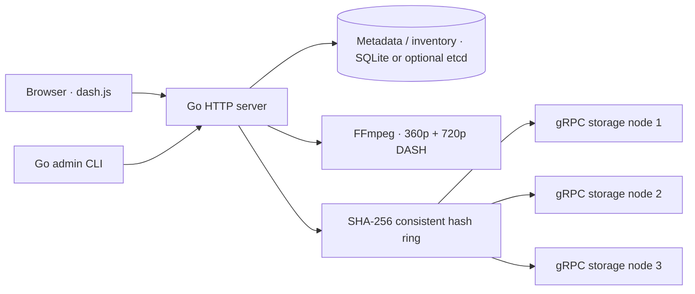

# TritonTube — Distributed Video Hosting Platform

See [INTERVIEW_DEMO.md](INTERVIEW_DEMO.md) for the rehearsed five-minute demonstration
and [the interview verification report](docs/INTERVIEW_VERIFICATION.md) for current results.

An original, runnable Go distributed video hosting demo: upload an MP4, transcode
it to two MPEG-DASH representations, stream independently placed media files,
and add or gracefully remove storage nodes without losing their content.

Repository: [Shreyasi08/TritonTube](https://github.com/Shreyasi08/TritonTube).
Module: `github.com/Shreyasi08/TritonTube`.



Each file is placed by `videoID/relativeFilename`, so segments of a video can
live on different nodes. See [DESIGN.md](DESIGN.md) for migration guarantees and
failure boundaries, and [the implementation plan](docs/IMPLEMENTATION_PLAN.md)
for phases and validation.

## Prerequisites

- Go **1.26+** (tested here with an isolated Go 1.27.4 toolchain).
- FFmpeg and ffprobe on PATH, with the `libx264` encoder. The local integration
  tests use actual media; they explicitly skip media tests when FFmpeg is absent.
- Docker Engine/Desktop and Compose v2 for the container workflow. Local execution
  needs neither Docker nor a SQLite installation; the SQLite driver is pure Go.
- protoc 3.20+ only for changing protobufs. Generated bindings are included.
- A modern browser with Media Source Extensions. dash.js is loaded from its
  pinned CDN URL; playback needs internet access to load that library. Fonts
  have system fallbacks.

## Local quick start

```sh
go test ./...
go build ./...
make build
```

Start these in **four separate terminals**, from the repository root:

```sh
./bin/storage -listen 127.0.0.1:9001 -data data/node1
./bin/storage -listen 127.0.0.1:9002 -data data/node2
./bin/storage -listen 127.0.0.1:9003 -data data/node3
./bin/web -listen 127.0.0.1:8080 -db data/metadata.db -work data/tmp
```

Generate sample media, then open **http://127.0.0.1:8080** and use the upload form:

```sh
make demo
# Or generate a different output (the script refuses to overwrite files):
./scripts/generate-sample.sh data/another-sample.mp4
```

Upload using the API instead:

```sh
curl --fail-with-body -F 'title=First light' -F 'file=@data/sample.mp4' \
  http://127.0.0.1:8080/api/videos
curl --fail http://127.0.0.1:8080/api/videos
./bin/admin health
```

A successful upload returns HTTP 201 with an ID and `status: ready`. Open the
corresponding library card or `/watch/ID`. The upload request stays open through
transcoding; the UI shows upload progress and a processing message. Metadata
polling shows other in-progress or failed uploads. Failed processing returns 422
and records the diagnostic in metadata. Processing/finalization errors include the
video ID in their JSON response and a Location header pointing to its metadata.
Nothing claims readiness until all media files and the manifest have been stored.

## Add and remove a node locally

Use the newly rebuilt binaries for web and all storage processes; restart any
processes from an older build before migrating (the storage Info RPC is required).
Keep the three original storage processes running. In a fifth terminal:

```sh
./bin/storage -listen 127.0.0.1:9004 -data data/node4
```

Then:

```sh
./bin/admin list
./bin/admin add node4 127.0.0.1:9004
./bin/admin migration
./bin/admin health
# Play the video again, then gracefully remove an existing node:
./bin/admin remove node2
./bin/admin list
./bin/admin health
```

Each storage directory has a persistent hidden `.node-id`. Migration rejects two
node names/addresses that report the same storage identity, including DNS aliases
or processes sharing a directory. Keep this file with its data; copying a directory
also copies its identity and does not create an independent node.

Stop node2 **after** removal returns `state: committed`. Reload the player and
verify playback. The CLI returns nonzero for failed requests or unhealthy nodes.
A committed migration can include `cleanup_errors` for retained obsolete copies;
new routing remains valid. Membership and virtual-node count are persisted in
the selected metadata backend, so restarting web keeps the latest topology. The `-nodes` flag seeds the
first startup only; do not edit it to perform a migration. The virtual-node count
(default 100, configurable with `-virtual-nodes`) cannot change against an existing
database. Stable IDs, addresses and storage directories must survive restarts.

## Docker Compose

Start Docker Desktop/Engine first:

```sh
make up
# Open http://127.0.0.1:8080, generate a sample on the host and upload it.
make demo
# Admin runs inside the web container (Go is not needed on the host):
docker compose exec web admin list
docker compose exec web admin health
# Start optional fourth storage process, then explicitly join it:
docker compose --profile scale up -d --wait storage4
docker compose exec web admin add node4 storage4:9001
docker compose exec web admin migration
docker compose exec web admin remove node2
docker compose stop storage2
# Verify video playback again before shutting down:
make down
```

Storage containers use standard gRPC health probes. The web container probes
`/healthz` with `web -health-check`, checking availability of the selected metadata backend and committed
storage-node health. Startup waits for the three storage nodes to become healthy.
These probes do not perform a full file-integrity scan or verify free disk space.

Named volumes retain metadata and node data. `make down` preserves volumes;
`make clean` only removes build/tool outputs. Starting the Compose cluster again
after joining node4 also requires `--profile scale` so that node remains online.
Compose waits for standard gRPC health checks before starting web. Only the HTTP
port is published, on host loopback. Storage addresses in Compose are container
DNS names, not host loopback addresses. Local and Compose runs have separate data.
Do not run both on host port 8080 simultaneously.

## HTTP and gRPC interfaces

| Method | Path | Result |
| --- | --- | --- |
| GET | `/` | Responsive upload form and video library |
| GET | `/healthz` | Metadata and storage health; 503 if degraded |
| POST | `/api/videos` | Multipart `file` MP4 and optional `title` |
| GET | `/api/videos` | All video metadata including processing state |
| GET | `/api/videos/{id}` | One record, or 404 |
| GET | `/watch/{id}` | DASH player; 409 until ready |
| GET, HEAD | `/stream/{id}/{filename}` | Verified content, ETag and byte ranges |
| GET | `/api/cluster/nodes` | Committed membership |
| GET | `/api/cluster/health` | Per-node health checks |
| GET | `/api/cluster/migration` | Last/current migration state |
| POST | `/api/cluster/nodes` | Add JSON `{"id":"node4","address":"host:port"}` |
| DELETE | `/api/cluster/nodes/{id}` | Gracefully remove a node |

The protobuf contract in `proto/storage/v1/storage.proto` defines streaming
Upload, Download and List RPCs, Delete, and Info for persistent storage identity.
Transfers use 64 KiB chunks with a 1 GiB per-file limit and mandatory SHA-256
verification on upload. Uploads use
confined filesystem roots and atomic rename after file sync. The standard gRPC
health service is available; `storage -health-check HOST:PORT` checks it.

## Development and tests

```sh
make proto        # Install pinned generators and regenerate protobuf Go files
make build        # bin/web, bin/storage, bin/admin
make check        # Formatting, vet, uncached regular/race tests and binary builds
make test         # All unit and integration tests
make test-race    # Same tests with Go race detector
make test-e2e     # Generate MP4s; decode HTTP DASH before/after compiled CLI add/remove
make test-compose # Build/run isolated containers; validate health, media, migration and restart
make test-etcd    # Race-test metadata continuity after leader failure in real 3-member etcd
make etcd-up      # Separate optional etcd deployment (project tritontube-etcd)
make etcd-down    # Stop the etcd deployment; retain volumes
make up           # Build and start the three-node Compose demo
make down         # Stop containers; retain volumes
make demo         # Generate a six-second sample MP4 using host FFmpeg
make clean        # Remove bin/ and .tools/ only
```

Tests start real loopback gRPC/HTTP servers and temporary SQLite databases.
They cover SHA-256 truncation, deterministic/colliding ring positions, wraparound,
limited remapping, path confinement, streaming round trips, concurrent storage,
SQLite restart/rollback, upload errors, actual FFmpeg DASH generation with/without
audio, HTTP ranges, manifest/segment retrieval and HTTP DASH decoding. Migration
tests exercise add/remove, restart from committed membership, partial-transfer
failure, source/destination checksum corruption, metadata commit failure, address
alias rejection and rejection of concurrent topology changes.
GitHub Actions defines Go validation, SQLite Compose lifecycle testing, and an
optional-backend three-member etcd leader-failure test on Ubuntu runners.
Local validation results are recorded separately; a remote CI run is not implied.
Run the genuine generated-media test independently with `make test-e2e`. It starts
three real gRPC nodes and an HTTP server with temporary SQLite storage, uploads
MP4s with and without audio, verifies ready metadata/library/player routes and
360p/720p representations, then decodes both video streams through the HTTP MPD.
It also builds and invokes the admin CLI, adds a storage node, gracefully removes
a node, stops the departed server and decodes the video again. Inventory checks
compare every HTTP file against its recorded SHA-256 after each membership change.
For a read-only audit of the normal Compose demo, run
`python3 scripts/inspect-distribution.py VIDEO_ID --plan-add node4` from the repository
root. This requires Python 3.9+, compares physical-node and HTTP checksums, and
independently calculates ring ownership. `--baseline PATH` verifies that no video
files/content were lost across a migration; `--virtual-nodes` must match the web
configuration (default 100). Audit JSON can be saved under ignored `data/`.
The script requires Go, FFmpeg and ffprobe and fails if any are missing.

`make test-compose` additionally requires a running Docker daemon, Compose v2+,
and host FFmpeg/ffprobe. It creates a unique project, image tag, named volumes and
dynamic loopback HTTP port, then removes its containers, volumes and image even on
normal test failures. It never uses the default demo project's data or image tag.
The test verifies initial playback, a fourth-node join, persisted four-node
membership after restarting web, graceful removal and playback after stopping that
node. Docker health status is checked separately from HTTP readiness. Hard process
termination can prevent deferred cleanup; failed-test output includes the project
name for targeted recovery. Do not use default-project `down --volumes` as cleanup
for an isolated test. The ordinary Go suite skips this opt-in Docker test; explicit
`make test-compose` fails if its prerequisites are unavailable.

Go is not on this workspace's original PATH. The isolated toolchain wrapper used
for local verification is `/tmp/tritontube-go-env`; for this session, for example:
`/tmp/tritontube-go-env make check`. A normal Go installation on PATH is sufficient
on another machine. Temporary tooling is not installed by the repository.

See [Phase 6 commands and outputs](docs/PHASE6_RESULTS.md),
[optional etcd setup and limitations](docs/ETCD.md),
[Phase 7 failover results](docs/PHASE7_RESULTS.md), and the
[historical validation record](docs/VALIDATION.md).

## Optional etcd metadata

The default SQLite mode remains unchanged. To start the independent three-member
etcd deployment and avoid the default demo's HTTP port:

```sh
TRITONTUBE_HTTP_PORT=8081 make etcd-up
# Open http://127.0.0.1:8081; this uses its own metadata and storage volumes.
make test-etcd
make etcd-down
```

`-metadata etcd`, `-etcd-endpoints` and `-etcd-prefix` select externally configured
client endpoints/namespaces for a native web process. See [ETCD.md](docs/ETCD.md)
for exact commands. Metadata uses the official client, linearizable reads and
revision-CAS transactions. The test abruptly kills the actual leader and verifies
metadata continuity/new uploads with two survivors, then verifies errors after
losing a second member. All media files remain unreplicated; this is metadata
process-failure continuity, **not storage-file fault tolerance**.

## Demo limits

- Run **one web process** per metadata namespace/database in either mode. SQLite
  is single-host metadata, not a distributed or fault-tolerant metadata service.
  Optional etcd replicates metadata, but does not make the web process or media
  storage fault tolerant. Back up metadata and storage consistently while stopped.
- No authentication, TLS, quotas or internet-facing hardening. Cluster mutations
  trust the administrator, including supplied node addresses. Use a trusted local
  network; do not expose these ports publicly.
- No replication or automatic recovery from unexpected storage loss. Graceful
  removal needs readable source files. A crash before topology commit leaves old
  routing and possibly extra destination copies; after commit, all destinations
  have been verified. Full power-loss durability across machines is not claimed.
- Topology changes pause file uploads/downloads while copying and committing.
  The migration-status endpoint remains readable. Migration requests time out
  after 10 minutes of context-bound work. In-process lock waits and bounded
  post-commit cleanup may extend wall-clock response time. Health probes can be
  temporarily degraded during a long migration. Docker marks health status but
  does not automatically restart a container merely because it is unhealthy.
  Large libraries need a resumable background migration design.
- At most two upload requests process concurrently, with a 512 MiB MP4 limit,
  10-minute duration limit and an 8-minute FFmpeg deadline. Request cancellation
  stops FFmpeg/RPC work. Only one source video stream and first audio stream are
  selected. 360p/720p may upscale small input. No thumbnail extraction or deletion UI.
- Transfers stay bounded in memory. HTTP responses and migration verification
  spool one file to disk for checksum checks/range support; provision free space.
  Normal errors remove temporary media. Hard process termination can leave temporary
  work, staging files or untracked copies if metadata recording failed after storage
  publication. Reconcile them manually while stopped; no automatic garbage collector.
  Concurrent viewer requests are not globally bounded and can exhaust spool space.
- Interrupted upload/processing records become failed when web restarts. Failed
  uploads retain recorded source/partial output for diagnosis and migration; they
  are not playable. No retry worker or automatic transcoding recovery.
- Optional etcd stores one CAS-protected JSON state capped at **1 MiB total encoded
  metadata**, rewriting it on each mutation. It is a small-library demo with five-second
  operation deadlines, no coordinator lease and no automatic SQLite import. An
  indeterminate remote topology commit fences further file writes/membership changes
  until metadata recovers and the coordinator is restarted. The three local etcd
  containers share a host; no host-failure or five-member/two-failure survival claim
  is made. Local etcd is plaintext and unauthenticated. See ETCD.md for details.
