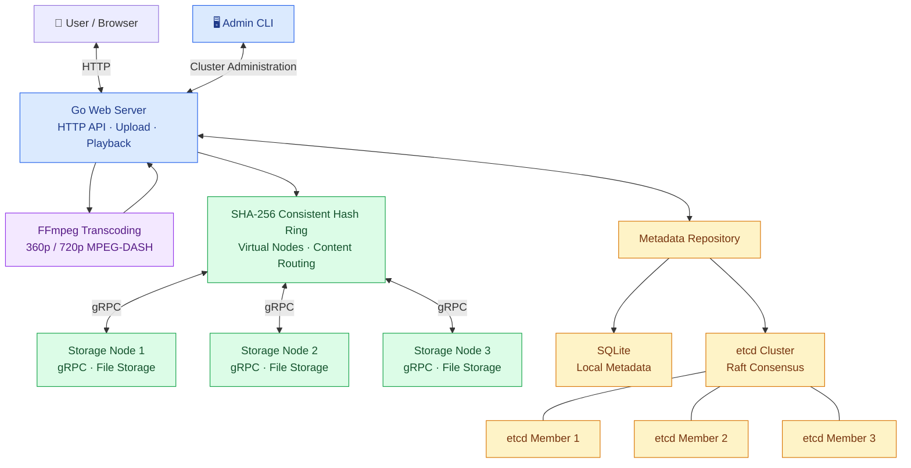
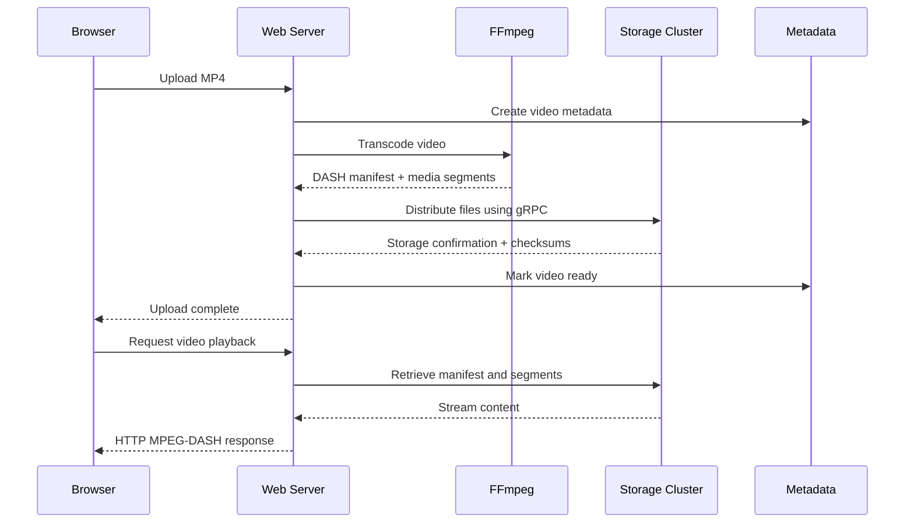

# TritonTube — Distributed Video Hosting Platform

A distributed, scalable, and fault-tolerant metadata-backed video hosting platform built using **Go, gRPC, and consistent hashing**.

TritonTube enables users to upload, store, and stream videos across multiple independent storage nodes. It supports adaptive MPEG-DASH streaming, dynamic cluster scaling, automatic file redistribution, and distributed metadata management using **etcd and the Raft consensus protocol**.

---

## 🚀 Features

- 📦 **Distributed Video Storage with Consistent Hashing**
  - Video files and segments are distributed across independent storage nodes using SHA-256-based consistent hashing.
  - Virtual nodes improve key distribution and minimize data movement when storage nodes are added or removed.

- 🔄 **Dynamic Cluster Scaling**
  - Add or remove storage nodes through a gRPC-backed Admin CLI.
  - Automatically redistribute affected files when cluster membership changes.
  - SHA-256 checksum verification protects file integrity during migration.

- 🎥 **Adaptive Video Streaming**
  - Upload MP4 videos directly through a web interface.
  - Automatically transcode videos into MPEG-DASH using FFmpeg.
  - Support 360p and 720p video representations for adaptive playback, including audio.

- ⚡ **gRPC-Based Microservices**
  - Go HTTP web server for uploads, playback, and content routing.
  - Independent gRPC storage servers for distributed file operations.
  - Admin CLI for cluster management and monitoring.

- 🛡️ **Fault-Tolerant Metadata**
  - SQLite for local metadata persistence.
  - Optional three-member etcd cluster using Raft consensus.
  - Metadata operations remain available after a single etcd member failure, provided quorum is maintained.

- 📊 **Reliability & Testing**
  - Health checks, structured logging, and cluster monitoring.
  - Automated unit, integration, race, and end-to-end tests.
  - Docker Compose deployment and GitHub Actions CI.

---

## 🛠️ Tech Stack

| Component | Technology |
|-----------|------------|
| Programming Language | Go |
| Client Communication | HTTP |
| Inter-Service Communication | gRPC, Protocol Buffers |
| Distributed Storage | Local filesystem across storage nodes |
| Consistent Hashing | SHA-256, uint64 hash ring, virtual nodes |
| Video Processing | FFmpeg, H.264, AAC |
| Adaptive Streaming | MPEG-DASH, dash.js |
| Metadata Storage | SQLite, etcd |
| Distributed Consensus | Raft (via etcd) |
| Containerization | Docker, Docker Compose |
| Testing | Go testing, race detector, integration tests |

---

## 🏗️ System Architecture



### Core Components

**1. Web Server**
- Handles HTTP requests for video uploads, browsing, and streaming.
- Coordinates FFmpeg transcoding and storage placement.
- Routes file requests to the appropriate storage node.
- Manages cluster membership and metadata operations.

**2. Storage Nodes**
- Independent Go servers exposing gRPC file services.
- Store MPEG-DASH manifests and media segments.
- Support streaming file uploads, downloads, and deletion.

**3. Consistent Hash Ring**
- Distributes files across storage nodes based on SHA-256 hashes.
- Uses virtual nodes for improved distribution.
- Recomputes ownership when nodes join or leave.

**4. Metadata Service**
- Stores video metadata, file inventory, and cluster configuration.
- Supports SQLite or an optional Raft-backed etcd cluster.

**5. Admin CLI**
- Lists cluster nodes.
- Adds and gracefully removes storage nodes.
- Monitors health and migration status.

---

## 📦 Consistent Hashing

TritonTube uses **SHA-256-based consistent hashing** to distribute video files across storage servers.

Each file is assigned a hash based on its video identifier and relative filename:

```text
key = videoID / relativeFilename
hash = SHA256(key) → uint64
```

Storage nodes are mapped onto a circular hash ring using virtual nodes.

The file is assigned to the first virtual node encountered clockwise from its hash position.

### Why Consistent Hashing?

Traditional modulo hashing can remap a large portion of stored content whenever the number of servers changes.

Consistent hashing reduces unnecessary redistribution by changing ownership only for affected hash ranges.

When a new storage node joins:

1. The node is added to the hash ring.
2. The system calculates updated file ownership.
3. Affected files are copied to their new nodes.
4. Checksums verify successful transfers.
5. Cluster membership changes are committed after verification.
6. Obsolete source copies can be cleaned up safely.

The same mechanism supports graceful storage-node removal.

---

## 🎬 Video Upload & Streaming Workflow



Videos are transcoded into MPEG-DASH format with 360p and 720p representations.

The browser uses **dash.js** for adaptive playback, allowing the player to select an appropriate representation based on network conditions.

---

## 🛡️ Fault-Tolerant Metadata with Raft

TritonTube supports an optional three-member etcd cluster for distributed metadata storage.

etcd uses the **Raft consensus algorithm** to coordinate replicated metadata.

- One member acts as the Raft leader.
- Metadata writes are replicated through the Raft log.
- A majority quorum is required for progress.
- If the leader fails, the remaining members can elect a replacement.

For a three-member cluster:

```text
Cluster size:       3
Required quorum:    2
Tolerated failures: 1
```

**Important:** Raft replication protects metadata availability. Video files themselves are not replicated, so unexpected storage-node loss can still make video content unavailable.

---

## 💻 Getting Started

### Prerequisites

- Go 1.26+
- FFmpeg and ffprobe
- Docker Desktop / Docker Compose (optional)
- Protocol Buffers compiler (only when regenerating protobuf code)

### 1. Clone the Repository

```bash
git clone https://github.com/Shreyasi08/TritonTube.git
cd TritonTube
```

### 2. Build the Project

```bash
go mod download
make build
```

### 3. Start Storage Servers

Open three separate terminals:

**Storage Node 1**

```bash
./bin/storage -listen 127.0.0.1:9001 -data data/node1
```

**Storage Node 2**

```bash
./bin/storage -listen 127.0.0.1:9002 -data data/node2
```

**Storage Node 3**

```bash
./bin/storage -listen 127.0.0.1:9003 -data data/node3
```

### 4. Start Web Server

In another terminal:

```bash
./bin/web -listen 127.0.0.1:8080 \
  -db data/metadata.db \
  -work data/tmp
```

Open:

**http://127.0.0.1:8080**

### 5. Upload and Stream a Video

Generate a sample MP4:

```bash
make demo
```

Upload `data/sample.mp4` through the web interface.

The system automatically:
- Transcodes the video into MPEG-DASH.
- Distributes media files across storage nodes.
- Records metadata.
- Makes the video available for browser playback.

---

## 🔄 Dynamic Cluster Management

### List Storage Nodes

```bash
./bin/admin list
```

### Add a Storage Node

Start a fourth storage server:

```bash
./bin/storage -listen 127.0.0.1:9004 -data data/node4
```

Register it with the cluster:

```bash
./bin/admin add node4 127.0.0.1:9004
```

### Monitor Migration

```bash
./bin/admin migration
```

### Remove a Storage Node

```bash
./bin/admin remove node2
```

Wait for migration to commit before shutting down the removed storage server.

### Check Cluster Health

```bash
./bin/admin health
```

---

## 🐳 Docker Deployment

Launch the default three-node system:

```bash
make up
```

Access the application at:

**http://127.0.0.1:8080**

Check running services:

```bash
docker compose ps
```

Add an optional fourth storage container:

```bash
docker compose --profile scale up -d --wait storage4
docker compose exec web admin add node4 storage4:9001
```

Stop the application:

```bash
make down
```

### Optional etcd Cluster

Launch the separate Raft-backed metadata deployment:

```bash
TRITONTUBE_HTTP_PORT=8081 make etcd-up
```

Access it at:

**http://127.0.0.1:8081**

Run the etcd failover tests:

```bash
make test-etcd
```

Stop the deployment:

```bash
make etcd-down
```

---

## 🧪 Testing & Validation

TritonTube includes automated tests for distributed storage, consistency, video streaming, and fault tolerance.

### Run Tests

```bash
make test
make test-race
make test-e2e
make test-compose
make test-etcd
```

### Verified Results

| Test | Result |
|------|--------|
| Unit and integration tests | Passed |
| Go race detector and builds | Passed |
| Docker Compose integration | Passed |
| Video upload and DASH decoding | Passed |
| Distributed file placement | 15/15 files verified |
| Node addition | 4 files migrated successfully |
| Node removal | 4 files migrated successfully |
| Playback following migration | Passed |
| etcd leader failure | Metadata operations continued |
| etcd quorum loss | Operations correctly failed |
| Browser video and audio playback | Verified |

Validation includes real HTTP and gRPC servers, generated media files, checksum comparisons, and cluster migration tests.

See [Interview Verification Report](docs/INTERVIEW_VERIFICATION.md) for detailed test results.

---

## 🗂️ Repository Structure

```text
TritonTube/
├── cmd/
│   ├── web/             # HTTP web server
│   ├── storage/         # gRPC storage servers
│   └── admin/           # Cluster management CLI
├── internal/
│   ├── api/             # HTTP handlers
│   ├── hashring/        # Consistent hashing
│   ├── storage/         # Distributed file storage
│   ├── metadata/        # SQLite and etcd backends
│   ├── transcode/       # FFmpeg processing
│   ├── cluster/         # Node membership and migration
│   └── observability/   # Health and logging
├── proto/               # Protocol Buffer definitions
├── web/                 # Frontend templates and assets
├── scripts/             # Development and testing scripts
├── tests/               # Integration tests
├── docs/                # Documentation and verification
├── docker-compose.yml
├── Makefile
├── DESIGN.md
├── INTERVIEW_DEMO.md
├── go.mod
└── README.md
```

---

## ⚠️ Current Limitations

- Video media files are not replicated across storage nodes.
- Unexpected storage-node failures do not trigger automatic recovery.
- The web coordinator is currently a single point of failure.
- Cluster migration temporarily pauses file operations.
- The system is intended for local development and demonstration; authentication, TLS, and production-scale orchestration are not implemented.

Future improvements could include replicated media storage, background migration, automatic failure recovery, and horizontal scaling of the web coordinator.

---

## 📚 Documentation

- [System Design](DESIGN.md)
- [Interview Demo Guide](INTERVIEW_DEMO.md)
- [Verification Report](docs/INTERVIEW_VERIFICATION.md)
- [etcd Setup & Limitations](docs/ETCD.md)


**TritonTube — Exploring distributed systems through scalable video storage, streaming, and fault-tolerant metadata management.**
